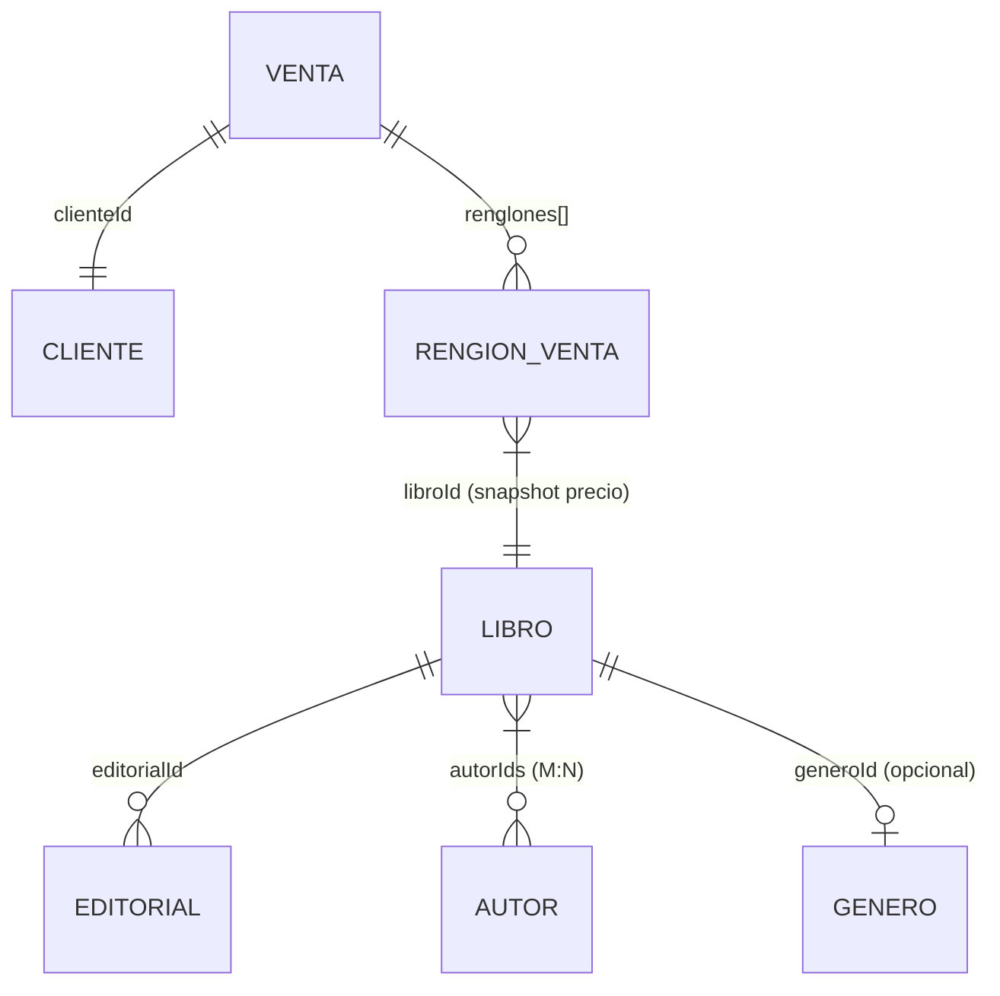

# Modelo de Datos

## Entidades y Atributos

### Libro
| Atributo | Tipo | Restricciones | Descripción |
|----------|------|---------------|-------------|
| `id` | string | Único, generado (`Date.now().toString(36) + random`) | PK estable, no índice de array |
| `titulo` | string | Requerido, `trim() !== ""` | Título del libro |
| `isbn` | string | Requerido, único (normalizado), `replace(/[\s-]/g, '').toUpperCase()` | ISBN-10/13 sin validar dígito control |
| `precio` | number | Requerido, `> 0`, 2 decimales | Precio en ARS |
| `editorialId` | string | Requerido, FK → Editorial.id | Editorial del libro |
| `generoId` | string \| null | Opcional, FK → Genero.id \| null | Género o "Sin clasificar" |
| `autorIds` | string[] | Requerido, `length ≥ 1`, cada uno FK → Autor.id | Autores del libro |

### Editorial
| Atributo | Tipo | Restricciones | Descripción |
|----------|------|---------------|-------------|
| `id` | string | Único, generado | PK |
| `nombre` | string | Requerido, único, `trim() !== ""` | Nombre de la editorial |

### Género
| Atributo | Tipo | Restricciones | Descripción |
|----------|------|---------------|-------------|
| `id` | string | Único, generado | PK |
| `nombre` | string | Requerido, único, `trim() !== ""` | Nombre del género |

### Autor
| Atributo | Tipo | Restricciones | Descripción |
|----------|------|---------------|-------------|
| `id` | string | Único, generado | PK |
| `nombre` | string | Requerido, único, `trim() !== ""` | Nombre del autor |

### Cliente
| Atributo | Tipo | Restricciones | Descripción |
|----------|------|---------------|-------------|
| `id` | string | Único, generado | PK |
| `nombreCompleto` | string | Requerido, `trim() !== ""` | Nombre completo (sin campo apellido separado) |
| `email` | string | Requerido, único (case-insensitive + trim), formato básico `/^[^\s@]+@[^\s@]+\.[^\s@]+$/` | Email de contacto |

### Venta
| Atributo | Tipo | Restricciones | Descripción |
|----------|------|---------------|-------------|
| `id` | string | Único, generado | PK |
| `fecha` | string | Requerido, ISO 8601 (`new Date().toISOString()`) | Timestamp de confirmación |
| `clienteId` | string | Requerido, FK → Cliente.id | Cliente de la venta |
| `renglones` | RenglónVenta[] | Requerido, `length ≥ 1` | Detalle de items |
| `total` | number | Requerido, `≥ 0`, 2 decimales | Suma de subtotales |

### RenglónVenta
| Atributo | Tipo | Restricciones | Descripción |
|----------|------|---------------|-------------|
| `libroId` | string | Requerido, FK → Libro.id (al momento de confirmar) | Libro vendido |
| `cantidad` | number | Requerido, entero `> 0` (`Number.isInteger`) | Unidades vendidas |
| `precioUnitarioSnapshot` | number | Requerido, `> 0`, 2 decimales | **Copia del precio del libro al confirmar** (inmutable) |
| `subtotal` | number | Requerido, `cantidad * precioUnitarioSnapshot`, 2 decimales | Subtotal del renglón |
| `titulo` | string | Requerido | Título del libro (snapshot para legibilidad) |
| `isbn` | string | Requerido | ISBN del libro (snapshot) |

## Relaciones (ERD)



## Datos Semilla (Mínimos Requeridos)
- **≥ 6 libros** con editoriales, géneros, autores válidos
- **≥ 2 editoriales**
- **≥ 2 géneros**
- **≥ 3 autores**
- **≥ 3 clientes**
- IDs estables (no índices de array)

Ejemplo estructura en `data.js`:
```javascript
const seed = {
  editoriales: [
    { id: "ed1", nombre: "Editorial Sudamericana" },
    { id: "ed2", nombre: "Penguin Random House" }
  ],
  generos: [
    { id: "gen1", nombre: "Ficción" },
    { id: "gen2", nombre: "No Ficción" }
  ],
  autores: [
    { id: "aut1", nombre: "Jorge Luis Borges" },
    { id: "aut2", nombre: "Julio Cortázar" },
    { id: "aut3", nombre: "Adolfo Bioy Casares" }
  ],
  libros: [
    {
      id: "lib1",
      titulo: "Ficciones",
      isbn: "978-987-1234-56-7",
      precio: 1500.00,
      editorialId: "ed1",
      generoId: "gen1",
      autorIds: ["aut1", "aut2"]
    }
    // ... 5 más
  ],
  clientes: [
    { id: "cli1", nombreCompleto: "Juan Pérez", email: "juan@email.com" }
    // ... 2 más
  ],
  ventas: []
};
```

## Esquema localStorage
| Clave | Contenido | Notas |
|-------|-----------|-------|
| `libreria_libros` | `Libro[]` | Incluye semilla + altas usuario |
| `libreria_clientes` | `Cliente[]` | Incluye semilla + altas usuario |
| `libreria_ventas` | `Venta[]` | Solo ventas confirmadas |
| `libreria_editoriales` | `Editorial[]` | Opcional, para consistencia selectores |
| `libreria_generos` | `Genero[]` | Opcional |
| `libreria_autores` | `Autor[]` | Opcional |
| `libreria_inicializado` | boolean | Flag semilla única (`true` tras primer carga) |

## Convenciones de IDs
- Formato: `Date.now().toString(36) + Math.random().toString(36).substr(2, 5)` → ej: `"k3j2h1f4a7b9c"`
- Nunca usar índices de array como ID (se rompen al borrar/ordenar)
- Strings por compatibilidad JSON/localStorage