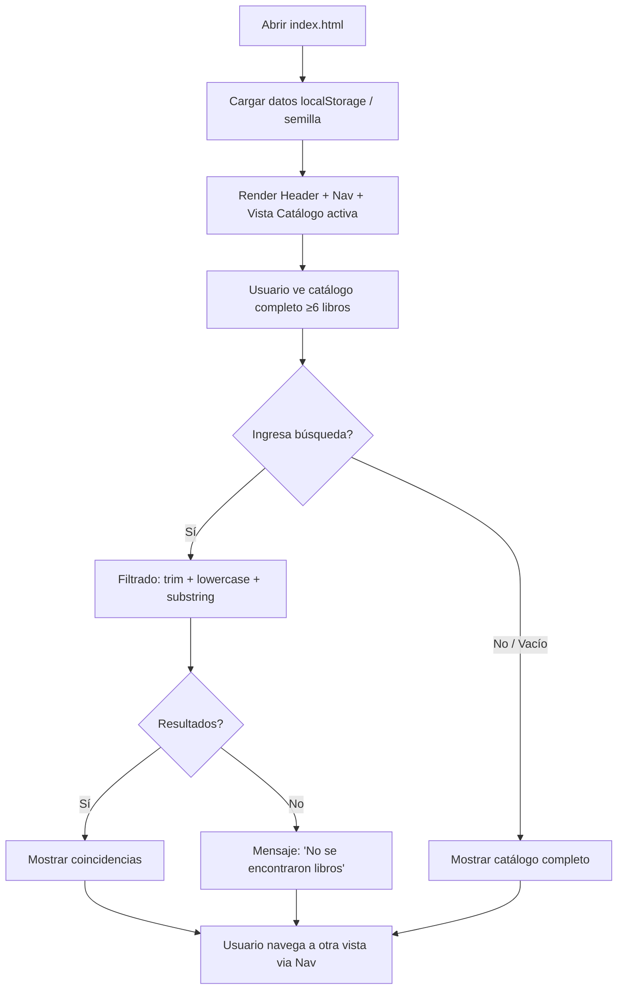

# Flujos Principales

> Flujos extremo a extremo (E2E) que el sistema debe soportar. Cada flujo referencia reglas de negocio (RN-XX) y historias de usuario (HU-XX).

---

## Flujo 1: Navegación Inicial y Exploración del Catálogo (Cliente)



**Pasos Detallados**
1. **Carga inicial**: `DOMContentLoaded` → `inicializar()` (RN-PER-02/03) → `renderCatalogo()` (HU-07)
2. **Catálogo visible**: Grid/listado de tarjetas con título, ISBN, editorial, género ("Sin clasificar" si null RN-CAT-04), autores, precio 2 decimales
3. **Búsqueda**: Event `input`/`submit` en buscador → `filtrarLibros(termino)` (RN-CAT-01/02/03)
4. **Navegación**: Click en Nav → `mostrarVista('libros'|'clientes'|'ventas'|'historial')` (HU-01)

**Reglas**: RN-CAT-01 a RN-CAT-05, RN-PER-01 a RN-PER-03, RN-UX-02, RN-UX-04
**HUs**: HU-01, HU-02, HU-07, HU-08

---

## Flujo 2: Alta de Libro (Empleado)

```mermaid
flowchart TD
    A[Nav → Vista Libros] --> B[Ver formulario alta + listado actual]
    B --> C[Completa campos: título, ISBN, precio, editorial, género, autores]
    C --> D[Click 'Guardar' / Submit]
    D --> E[preventDefault + Validaciones RN-LIB-01 a 06]
    E -- Error --> F[Mostrar errores cerca del formulario]
    F --> C
    E -- OK --> G[Agregar a libros[] + localStorage]
    G --> H[Actualizar listado libros + selectores venta]
    H --> I[Limpiar formulario + mensaje éxito]
    I --> B
```

**Validaciones Clave (RN-LIB)**
- Título no vacío
- ISBN normalizado único (sin espacios/guiones, case-insensitive)
- Precio > 0 numérico
- Editorial existente
- Género: null o existente
- ≥1 autor, todos existentes

**Reglas**: RN-LIB-01 a RN-LIB-10, RN-PER-01, RN-UX-01, RN-UX-02
**HUs**: HU-09, HU-11

---

## Flujo 3: Alta de Cliente (Empleado)

```mermaid
flowchart TD
    A[Nav → Vista Clientes] --> B[Ver formulario alta + listado actual]
    B --> C[Completa: nombre completo, email]
    C --> D[Click 'Guardar' / Submit]
    D --> E[preventDefault + Validaciones RN-CLI-01 a 03]
    E -- Error --> F[Mostrar errores cerca del formulario]
    F --> C
    E -- OK --> G[Agregar a clientes[] + localStorage]
    G --> H[Actualizar listado clientes + selector venta]
    H --> I[Limpiar formulario + mensaje éxito]
    I --> B
```

**Validaciones Clave (RN-CLI)**
- Nombre completo no vacío
- Email formato válido + único (trim + lowercase)

**Reglas**: RN-CLI-01 a RN-CLI-05, RN-PER-01, RN-UX-01, RN-UX-02
**HUs**: HU-10, HU-11

---

## Flujo 4: Composición y Confirmación de Venta (Empleado)

```mermaid
flowchart TD
    A[Nav → Vista Ventas] --> B[Ver formulario venta: selector cliente + composer renglones]
    B --> C{Selecciona cliente?}
    C -- No --> D[Error: 'Seleccione un cliente' RN-VTA-01]
    C -- Sí --> E[Agregar renglón: select libro + input cantidad]
    E --> F{Validar renglón RN-VTA-03/04}
    F -- Error --> G[Mensaje error en renglón]
    F -- OK --> H[Verificar duplicado RN-VTA-05]
    H -- Duplicado --> I[Modificar cantidad existente O informar]
    H -- Nuevo --> J[Agregar renglón a array temporal]
    J --> K[Recalcular subtotales RN-VTA-06 + total RN-VTA-07]
    K --> L{Más renglones?}
    L -- Sí --> E
    L -- No --> M[Click 'Confirmar Venta']
    M --> N[Validación final RN-VTA-10]
    N -- Error --> O[Mostrar errores]
    N -- OK --> P[Crear objeto Venta con snapshot precios RN-VTA-08/09]
    P --> Q[Guardar en ventas[] + localStorage RN-PER-01]
    Q --> R[Limpiar formulario + mensaje éxito RN-VTA-12]
    R --> B
```

**Detalles Críticos**
- **Snapshot de precio**: Al confirmar, cada renglón copia `libro.precio` → `precioUnitarioSnapshot`. Este valor **nunca** se actualiza.
- **Datos descriptivos**: Renglón guarda `titulo`, `isbn` (mínimo) para legibilidad en historial sin consultar catálogo.
- **Inmutabilidad**: Una vez confirmada, la venta no se edita/elimina (RN-VTA-13, RN-HIS-04).

**Reglas**: RN-VTA-01 a RN-VTA-13, RN-PER-01, RN-PER-03, RN-UX-01, RN-UX-02
**HUs**: HU-12, HU-13

---

## Flujo 5: Consulta de Historial y Detalle (Empleado)

```mermaid
flowchart TD
    A[Nav → Vista Historial] --> B[Cargar ventas[] desde localStorage]
    B --> C[Render tabla: id, fecha legible, cliente, total 2dec]
    C --> D{Click 'Ver detalle' en fila?}
    D -- Sí --> E[Buscar venta por id]
    E --> F[Render modal/section detalle]
    F --> G[Mostrar renglones: libro, cantidad, precioUnitarioSnapshot, subtotal]
    G --> H[Usuario cierra detalle]
    H --> C
    D -- No --> I[Usuario navega a otra vista]
```

**Puntos Clave**
- `precioUnitarioSnapshot` **siempre** usado (RN-HIS-03)
- Fecha formateada legible (ej: `dd/mm/yyyy hh:mm`)
- Cliente: mostrar `nombreCompleto` (join con `clientes[]`)
- Sin botones editar/eliminar (RN-HIS-04)

**Reglas**: RN-HIS-01 a RN-HIS-04, RN-PER-01, RN-PER-03
**HUs**: HU-14, HU-15

---

## Flujo 6: Persistencia Entre Sesiones (Sistema)

```mermaid
flowchart TD
    A[Usuario cierra pestaña/navegador] --> B[Datos ya en localStorage]
    B --> C[Usuario reabre index.html mismo navegador/perfil/ubicación]
    C --> D[DOMContentLoaded → inicializar()]
    D --> E{Flag 'libreria_inicializado' existe?}
    E -- Sí --> F[Leer libros, clientes, ventas desde localStorage]
    E -- No --> G[Escribir semilla + flag]
    F --> H[Render vistas con datos recuperados]
    G --> H
    H --> I[Sin duplicados de semilla ni ventas]
```

**Reglas**: RN-PER-01 a RN-PER-05
**HUs**: HU-16

---

## Flujo 7: Casos de Prueba Manuales (Validación Docente)

| Caso | Flujo Relacionado | Resultado Esperado |
|------|-------------------|-------------------|
| Búsqueda mayúsculas → vacía → inexistente | Flujo 1 | Coincide sin case; catálogo completo; mensaje sin resultados |
| Alta libro ISBN duplicado → ISBN nuevo | Flujo 2 | Duplicado rechazado; nuevo aparece en catálogo y selector venta |
| Alta cliente email inválido → existente (mayúsculas) → nuevo | Flujo 3 | 2 primeros rechazados; nuevo en listado y selector |
| Venta sin cliente / cantidad 0/negativa/decimal / libro repetido | Flujo 4 | No confirma; duplicado no crea renglón extra |
| Venta válida: 2×1500 + 1×2000 | Flujo 4 | Subtotales 3000, 2000; total 5000; detalle conservado |
| Venta confirmada → cambio precio catálogo en localStorage → recarga → ver historial | Flujo 5 + 6 | Precio unitario, subtotales, total **conservan valores originales** |
| Recarga tras altas y venta | Flujo 6 | Datos recuperados sin duplicar ejemplos ni ventas |
| Navegación teclado + 320px / 1280px | Flujo 1 + 2 | Foco visible, controles usables, tabla scroll propio si necesario |

---

## Matriz de Flujos vs Ejercicios

| Flujo | Ejercicios Cubiertos |
|-------|---------------------|
| 1. Navegación + Catálogo | 1, 2, 3 |
| 2. Alta Libro | 1, 2, 4 |
| 3. Alta Cliente | 1, 2, 4 |
| 4. Venta (composición + confirmación) | 1, 2, 5 |
| 5. Historial + Detalle | 1, 2, 5 |
| 6. Persistencia | 6 |
| 7. Casos Manuales | 6 (documentación en README) |